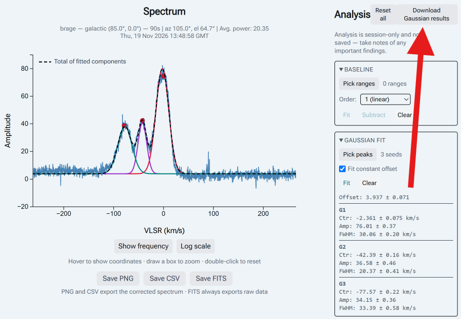

# salsa-download-gaussians
Tiny JS script for downloading the fitted gaussians from https://salsa.oso.chalmers.se/observations.



## How to use
1. Copy the contents of `download_script.js` (Ctrl+C).
2. In the observations archive, press Ctrl+Shift+I to open the console.
3. Select the "console" tab if it isn't already selected.
4. Paste the contents (Ctrl+V) and press Enter.

If the "Download Gaussian results" button appeared, everything worked.

Note that the script needs to be re-run when the page is reloaded or you flip to another page of the observations archive.

## Results
The downloaded data is a CSV file with columns for peak number, center (in km/s or MHz), amplitude, and Full Width Half Maximum, with errors for each of the last three.

Example: File from the above image.
```csv
peak_number,ctr,ctr_err,amp,amp_err,fwhm,fwhm_err
1,-2.361,0.075,76.01,0.37,30.06,0.20
2,-42.39,0.16,36.58,0.46,20.37,0.41
3,-77.57,0.22,34.15,0.36,33.39,0.58
```